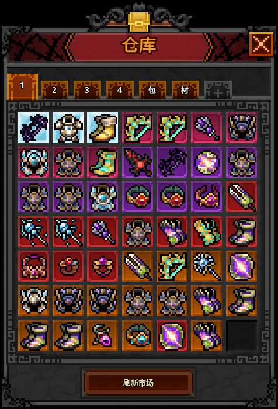

# TaskbarHero 仓库查看器（TBH Stash Viewer）

给《TaskBar Hero》（Steam appid 3678970）按原版 UI 复刻的仓库/背包查看器：脱离游戏窗口单独打开，能看全部页签的物品，并显示**人民币**最低价与近 24 小时成交中位价。

**版本：v1.0.3**



## 功能

- 复刻原版仓库面板：仓库多页 / 背包 / 材料库页签、品阶底色、图标、数量角标，无边框窗口 + 点击标题栏拖动、四角拖拽缩放（1.0×～4.0×）。
- 价格全人民币：**不需要登录**，匿名接口 `priceoverview?currency=23` 一次就返回最低价、近 24 小时成交中位与成交量；登录态是可选的，只在 429 限流后的兜底路径里有用（见下面「登录态（可选）」）。
- 悬停格位显示：最低价、近 24 小时成交量加权中位、成交量、更新时间；价格表里已有数据时先秒显，再按需现拉。
- 按 2 小时节奏维护：只刷**仓库 / 背包 / 材料库**里的物品，只补超过 105 分钟没更新的；新进物品先解析市场名（英文名 + 品阶核验）再取价。
- 底部状态按钮：手动补刷一轮过期物品；状态分「已完成 · N 件 / 限流 · 已存 N 件 / 限流中 · HH:MM 重试 / 更新失败 · 将重试」，限流或失败时使用灰色按钮底图，其余为原版棕色。
- 关游戏即退：游戏进程消失 2 秒后查看器自动关闭；工具是手动单独启动、游戏本来没开时不会自爆。

## 环境要求

- Windows 10/11
- Python 3.10+（实测 3.12）
- 本机装有《TaskBar Hero》
- （可选）代理：默认走 `http://127.0.0.1:7890`，可用环境变量 `STEAM_PROXY` 覆盖；不设代理也能直连，只是更早触发限流

## 安装

```bat
pip install -r requirements.txt
```

## 素材准备（重要）

仓库**不附带游戏素材**：`ui/`（面板、按钮、页签图）、`icons/`（物品图标）、`csv/` 与 `items_zh.csv`（物品表/中文名）、`localization_zh.json` 都是从游戏本体提取或派生的，版权归游戏方，请用你自己机器上的游戏副本生成：

```bat
python tools\extract_sprites.py --list --filter Button      :: 先看有哪些 Sprite
python tools\extract_sprites.py                             :: 提取默认按钮组到 .\ui
```

`icons/` 与 `items_zh.csv` 需要从游戏资源与本地化表导出（字段对应：`csv/ItemInfoData.csv` 的图标名 → `icons/<名字>.png`，英文名/中文名来自本地化 bundle）。缺失时查看器仍能打开，只是格子没有图标、没有中文名。

## 运行

```bat
start.bat
```

等价于：

```bat
pythonw -X utf8 stash_viewer.py
```

### 随游戏一起启动（Steam 启动选项）

Steam → 库 → 右键《TaskBar Hero》→ 属性 → 启动选项：

```
C:\Windows\System32\wscript.exe "<本文件夹路径>\start_with_game.vbs" %command%
```

`start_with_game.vbs` 会先无窗口拉起查看器，再把 `%command%` 原样转给游戏（Steam 直接执行首个 token，所以不用 `cmd /c`）。查看器内部有单实例互斥量，重复拉起只会静默退出。

## 登录态（可选）

**不登录也能完整使用**：最低价、近 24 小时成交中位、成交量都来自匿名 `priceoverview?currency=23`，2 小时一轮的自动维护、底部按钮手动补过期、悬停看价都不依赖登录。

登录态只影响两处兜底路径（这两条都必须登录才走得通）：

- **429 限流后的补价**：没登录时，`fast_refresh` 在 `get_auth().cookies()` 为空时直接返回，本轮只能等冷却（按钮显示「限流中 · HH:MM 重试」）；有登录则改用市场搜索页按 `q=` 关键字补那些 105 分钟以上没更新的物品。
- **中位/成交量补算**：`pricehistory` 接口匿名返回 400，只有登录能读；没登录时中位就用 `priceoverview` 自带的 `median_price` 字段。

需要的话，两种方式任选其一：

```bat
:: 方式一：开登录窗口，抓到 Cookie 后自动关窗（长效令牌约 200 天，续期自动）
pythonw -X utf8 steam_login.py
pythonw -X utf8 steam_login.py --status      :: 只看令牌有效期

:: 方式二：从本机 Steam / Chrome / Edge 的 cookie 库直接读令牌
python extract_steam_token.py
```

不想用登录就什么都不用做；已有的 `steam_cookies.json`、`steam_token_cache.json`、`edge_login_profile\` 也可以直接删掉，查看器会自动跳过兜底分支。冷却期间悬停不会发请求，只显示价格表里已有的数据。

## 目录结构

```
stash_viewer.py        查看器主程序（Tk + 原版 UI 拼图）
update_prices.py       人民币取价：priceoverview / 市场页兜底 / pricehistory 中位 / 冷却与限速
market_names.py        新物品市场名解析（本地化英文名 + 品阶核验 + 缓存）
steam_login.py         登录窗口 + CDP 抓 Cookie + 自动关窗（**可选**，--status / --selftest）
extract_steam_token.py 备用：从 Steam/Chrome/Edge 的 cookie 库读登录令牌
start_with_game.vbs    Steam 联动启动（先开查看器，再转游戏命令）
start.bat              手动启动
tools/extract_sprites.py  从游戏本体提取 UI Sprite
ui/ icons/ csv/        游戏素材与派生数据（.gitignore，需自行提取）
item_prices.json       价格表（本地缓存，含最低价 / 中位 / 成交量 / 时间戳）
```

## 数据与隐私

运行时会生成这些**仅存本机**的文件（都已写进 `.gitignore`）：

- `item_prices.json`：价格表
- `steam_cookies.json` / `steam_token_cache.json` / `edge_login_profile/`：Steam 登录态（**可选**，不登录不会生成；含明文令牌，**不要分享或上传**）
- `market_names.json` / `en_names_cache.json`：市场名解析缓存
- `viewer_prefs.json`：缩放比例
- `prices_log.txt` / `fg_debug.log` / `launch_log.txt`：运行日志

## 已知限制

- `priceoverview` 有额度：实测约 500 件 / 周期后开始 429，换 IP 与换 UA 都不改变结论；脚本按 5→15→30→60→60 分钟阶梯冷却，冷却结束后自动续刷。
- 未登录时 429 后没有市场页兜底，这段时间只能等冷却；想缩短就用「登录态（可选）」里的任一方式补一次登录。
- Steam 的 `search/render`、`listrender` 列表接口已整站下线（真实登录浏览器同样 404），所以没有「一页拉全部」的通道，市场搜索页只能取到第一页 100 条，`start`/`sort` 参数被服务端忽略。
- 中位数是按小时聚合后按成交量加权的口径，与 Steam 官方逐笔成交中位可能相差几点（实测例子：188 vs 208）。
- 近 24 小时没有成交的物品，中位显示“—”。
- 仅支持 Windows。

## 版本与迭代

- 语义化版本 `MAJOR.MINOR.PATCH`，版本号写在 `stash_viewer.py` 的 `__version__`，启动时打一行 `price loop started · v1.0.0` 到 `prices_log.txt`。
- 每个版本：改代码 → 更新 `CHANGELOG.md` → `git tag -a vX.Y.Z` → 从 tag 出 Release。
- 分支约定：`main` 永远可运行；功能改动走 `feat/xxx`，修 bug 走 `fix/xxx`，合并前至少在本机跑通启动 + 一轮手动刷新。
- 配置不写死：`TBH_DATA_DIR`（数据根目录）、`TBH_SAVE`（存档路径）、`TBH_SAVE_PASSWORD`（存档解密口令）、`TBH_GAME_DIR`（游戏安装目录）、`TBH_PYTHON`（启动脚本用的 pythonw）、`STEAM_PROXY`（代理）都可用环境变量覆盖。

## 路线图

- v1.1：一键素材提取（`ui` + `icons` + `items_zh.csv` 全自动），首次运行配置向导。
- v1.2：中位改用官方逐笔口径；价格历史本地化，支持折线小图。
- 之后：多语言、非 Windows 平台的取价后端。

## 免责声明

本项目仅用于查看本机存档内容，与游戏开发方、Valve 无关联。请自行遵守游戏与 Steam 的服务条款；读取存档、访问市场接口的风险自负。代码按 MIT 许可，游戏素材与 Steam 数据不在许可范围内、也不随仓库分发。
